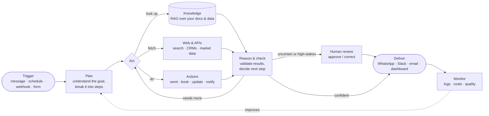
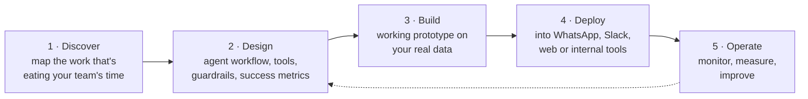

<div align="center">

# Aswanth Saranu
### Agentic AI Developer

**I build production-grade AI agents that take work off your team, and they actually work.**

[](https://aswanth05.github.io/Agenti-AI/)
[](https://wa.me/17325852231)

</div>

---

## What I build

| | Capability | What it does for your business |
|---|---|---|
| 💬 | **RAG Applications** | Assistants that answer from *your* documents and data, deployed on your website, WhatsApp, Slack or other messaging platforms. |
| 🔎 | **Research & Enrichment Agents** | Agents that pull data from the web and APIs, then clean, enrich and deliver it in the format your team needs. |
| 📈 | **Stock Market Research Agents & Dashboards** | Agentic research and analysis workflows for global markets, with dashboards that surface what matters. |
| 🧰 | **Custom Internal AI Tools** | Dashboards, AI applications and automations built around how your team actually works. |
| 📱 | **WhatsApp Automation & Agents** | Agents that answer, qualify, book and follow up with customers on WhatsApp, for businesses across industries. |

---

## Workflow definition: how my agents work

Every agent I ship follows the same production pattern. It is a controlled loop with tools, memory, guardrails and a human in the loop where it matters, not a single prompt.



| Stage | What happens | Why it matters in production |
|---|---|---|
| **Trigger** | A customer message, a schedule, a webhook or a form starts the run. | Agents fit into the tools your team already uses. |
| **Plan** | The agent turns the request into concrete steps. | Multi-step work gets done, not just a single reply. |
| **Act** | It calls tools: retrieval over your knowledge base, web/API lookups, and real actions. | Answers are grounded in your data, and work actually gets done. |
| **Reason & check** | Results are validated before anything moves on. | Fewer hallucinations, with clear failure handling. |
| **Human review** | Low-confidence or high-stakes steps are routed to a person. | You stay in control of what matters. |
| **Deliver** | Output lands where your team works: WhatsApp, Slack, email, dashboards. | No new app to adopt. |
| **Monitor** | Every run is logged with cost and quality signals. | Problems are caught early and the agent improves over time. |

---

## How we work together



1. **Discover:** we find the repetitive, high-volume work where an agent pays for itself.
2. **Design:** I define the workflow, the data it needs, what it may and may not do, and how we'll measure success.
3. **Build:** you see a working version on your own data early, not a slide deck.
4. **Deploy:** it goes live where your team and customers already are.
5. **Operate:** I monitor quality and cost, and keep improving it after launch.

---

## Agentic AI skills

**Agent design**
- Multi-step agents with planning, tool use and memory
- Multi-agent workflows (researcher → analyst → writer patterns)
- Guardrails, validation and human-in-the-loop approval
- Prompt and context engineering

**Retrieval & knowledge**
- RAG pipelines: ingestion, chunking, embeddings, vector search
- Grounded answers with source references
- Keeping knowledge bases fresh as documents change

**Integrations & automation**
- WhatsApp Business messaging and automation
- Slack, website chat widgets and other messaging platforms
- Web data extraction and third-party API integration
- Scheduled and event-driven workflows

**Data & dashboards**
- Market and financial data research pipelines
- Analytics dashboards for decision makers
- Data cleaning and enrichment at scale

**Production engineering**
- Deployment, logging and monitoring
- Cost and latency control
- Evaluation of agent output quality

---

## Projects

Featured projects are in the Projects section of the [live site](https://aswanth05.github.io/Agenti-AI/). Each card covers the problem, the solution, the tech stack and a link.

---

## Let's talk

Tell me what's eating your team's time, and I'll tell you honestly whether an AI agent can take it off their plate.

**[💬 Message me on WhatsApp](https://wa.me/17325852231)** · **[📅 Book a call](https://aswanth05.github.io/Agenti-AI/)**

---

<details>
<summary><strong>About this website (for maintenance)</strong></summary>

Static site (HTML + CSS + JS, no build step), hosted on GitHub Pages.

| What | Where |
|---|---|
| WhatsApp number, message, Web3Forms key | `assets/js/config.js` |
| Project cards | `assets/js/projects.js` |
| About text | `index.html`, the `#aboutText` paragraph |
| Photo | `assets/img/aswanth.jpg` |
| App name & icons (Add to Home Screen) | `manifest.webmanifest`, `assets/img/icon-*.png` |

**Preview locally:** `python3 -m http.server 8000`, then open http://localhost:8000

**Publish changes:**
```bash
git add -A && git commit -m "Describe the change" && git push
```
After changing CSS or JS, bump the `?v=` number on their links in `index.html` so phones load the new files.

</details>
